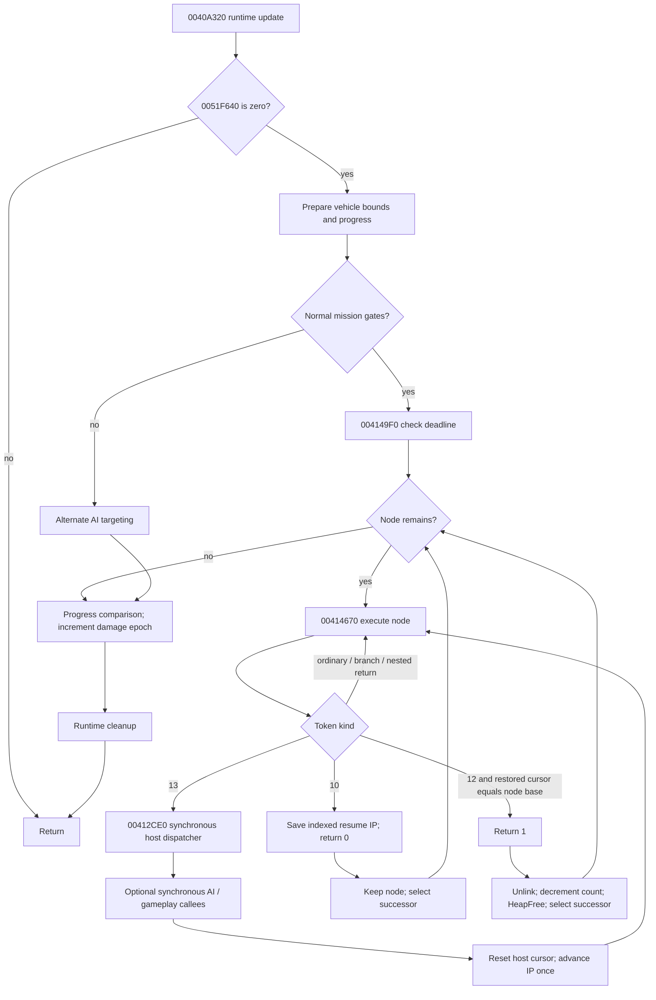

# Interpreter and scheduler control flow

This diagram summarizes verified direct control flow; dotted abstractions are described in the source sketch. Node-list equivalence assumes no indirect link mutation by host services.

Normal gates mean `!is_network_or_trip_runtime_mode() && 0051F5C0==0`. No timeout transition branch directly skips the node list. Fatal VM exit, host abort and memory faults can interrupt the illustrated normal path.

| State before action | Trigger | State after action | Scheduler consequence |
|---|---|---|---|
| Imported | relocation | seeded frame, address-valued IP/cursors, condition=0 | runnable |
| Runnable | interpreter entry | local retired count=0; persistent node retained | run until suspension |
| Executing | branch 8/9 | new IP within same node | no scheduler return |
| Executing | call 11 / nested return 12 | frame/IP/cursor adjusted | same invocation |
| Executing | host 13 | synchronous effects, host cursor reset, IP+8 | same invocation |
| Executing | yield 10 | IP set to explicit token index, all other node state retained | return 0; next list node this pass |
| Executing | return 12 restores cursor to node base | saved IP/frame restored | return 1; unlink and free |
| Executing | retired>800 at loop entry | shared budget latch set | execution continues |
| Executing | loop-tail count reaches 1000 | exit(0) | process termination, no yield |

For A→B→C, with A yielding, B completing and C yielding, visitation is A,B,C; the resulting list is A→C and pending count decreases by one. Next pass starts with A at its explicit yield target. For two completed heads followed by a yielded node, the third node still runs in the same pass. If all complete, head becomes null and timeout checks still occur on later scheduler invocations.

Frame geometry: call at S writes old-frame at S and return-IP at S+4, points frame to S+4, and moves operand cursor to S+8. Return p computes cursor=`frame-4*(p+1)` and restores prior frame from frame-4. The null saved outer frame is not the completion predicate: cursor equality is.

Cross-frame persistence includes node workspace, argument slots, condition and cursors; shared global words, actors, deadline and AI/event state also persist according to their own subsystem lifecycles. The budget **counter** and 80 local scratch bytes are per invocation; the budget **latch** is global. A host call to AI does not create a scheduler turn or establish recursive VM entry.

See `evidence/CLAIM_INSTRUCTION_MAP.tsv` for instruction anchors and `SEMANTIC_RECONSTRUCTION.md` for evidence limits.
