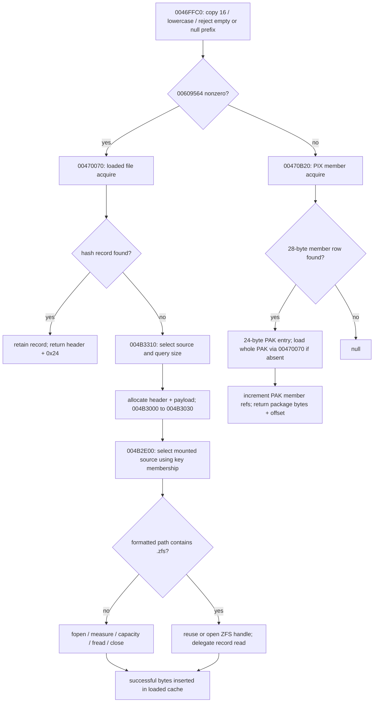

# Original acquisition paths, decisions and retention

Evidence tier throughout: **binary-static**; addresses refer to authenticated retail PE, with Ghidra range hashes in `evidence/STATIC_AUDIT.tsv` and `STATIC_AFTER.tsv`. This graph is explanatory, not original source-module recovery.

The graph omits cross-branch fallback edges for readability: the first branch's **null return** causes `0046FFC0` to call the other branch. A successful loaded-file cache hit bypasses fresh source selection, even if registry paths have changed. A member hit bypasses loaded-file acquisition when the whole PAK is already retained. The whole-PAK loader directly calls `00470070`, so the preference global does not recursively choose a PIX member named as its own package.

## Decisions and failures

| Original boundary | Decision / returned value | Ownership or qualification |
|---|---|---|
| `0046FFCF..0047000D` | Copy/lowercase before empty/`null` prefix checks | No safe input-null guard; 16-byte copy does not force termination |
| `0047000F..00470050` | Preference selects first attempt; null falls through to second | Establishes conditional priority only; no measured mission global state |
| `00470084..00470123` | Case-sensitive hash, case-insensitive chain comparison; hit retains | Returns inline bytes, not header; count is 16-bit |
| `00470124..00470164` | Purge threshold checked before size lookup; size <= 0 returns null | A failed request may already have evicted an unrelated purgeable record; zero-byte file cannot enter this cache path |
| `00470193..00470200` | Allocation retry evicts purge tail; failed read frees new allocation | No hash insertion for failed load; error reporter may intervene |
| `00470B3A..00470B49` | No PIX row → null | Allows other acquisition branch |
| `00470B65..00470BB2` | Load PAK once, increment member count, add offset | Failed backing load invokes reporter; if reporter returns, code still increments and adds offset to zero; not guaranteed clean null |
| `004B2E41..004B2E71` | Missing registered key → diagnostic + null | Does not search unregistered loose filenames |
| `004B2F03..004B2FD8` | Media-aware mode can close source handles and invoke callback | Callback failure returns null; not a pure lookup |
| `004B3030` / `004B3310` | Resolve one registered source, format its path, choose `.zfs` substring branch | No alternate-source retry on selected-source open/read failure |
| `004B3030` loose branch | Writes length; allocates if no destination, else capacity-checks; reads one item | Failed open leaves out-size unspecified; capacity/read failures may leave it set; failed read frees only self-allocated memory |
| `004B3131..004B317F` | Lazily open ZFS, caller-buffer boolean read or allocated read | Successful caller-buffer branch returns original destination; delegated decoder validation is out of scope |
| `00470340` | Indexed membership first, registered membership second | Does not establish readability, source selection, cache residency or reference ownership |

`report_error` is an inherited working name for `0042D5D0`. We did not establish whether it terminates, throws, or returns in all relevant configurations. A diagnostic call is not an observed return-to-caller failure policy. The allocation size diagnostic at `0047017D` checks header+payload against `0x7fff8`; if the reporter returns, allocation proceeds. It must not be described as an unconditional size rejection.

## Distinct records and lifetime

| Structure / original storage | Construction and fields | Owner / lifetime supported by inspected code |
|---|---|---|
| LoadedFile32; allocations on heap referenced by `00609594`, hash pointer `00609580` | Header `0x24`; name `+00[16]`, saved length `+10`, refs `+14:u16`, unknown `+16:u16`, hash next `+18`, purge links `+1C/+20`, inline bytes `+24` | RES cache owns allocation. Hit retains. Release to zero adds to purge queue; eviction `0046FBE0` unlinks and HeapFrees. Not safe to free payload pointer or use it after release/eviction |
| PixMember32; array pointer `0058D91C` | `0x1C`; key `+00[16]`, PAK index `+10`, offset `+14`, length `+18` | Index owns metadata. Row has no per-member payload allocation or reference field. Teardown timing not established |
| PakRetention32; array pointer `0058D920` | `0x18`; package filename `+00[16]`, package bytes `+10`, aggregate member refs `+14` | Keeps one loaded-file reference while members retained; index-array teardown not established |
| RegisteredKey32; heap-backed pointer `005DACC8` | `0x30`; key `+00[16]`, 256-bit source membership `+10..2F` | Registration may resize/sort it (`004B2B30`), so a key-row address is not a durable handle. No payload pointer |
| MountedSource32; static `006592E0`, 256 slots | `0x10C`; path `+00[256]`, mode `+100`, root/media index `+104`, cached archive handle `+108` | Resolver returns address in this static array. Cached archive handles may close on source/media switch; row address and handle lifetime differ |

The key table and source array are different even though both participate in registration. The source array's flag at `+100` affects path/media treatment, not archive compression or a uniform “resource loaded” state. The key bitmap is constructed by `004B2B30`; the source slot count used in registration/handle-close loops is `006562C8`, while source selection scans the bounded static capacity.

## Name-based release and caller obligations

`0046FD40` copies/lowercases and calls `00470BC0` first. If a member row exists, `00470BC0` reports success even when its PAK refcount was already zero. At a decrement to zero it calls `0046FE30(package_name)` and clears the cached PAK pointer. Otherwise `0046FD40` performs the direct loaded-file count decrement / purge insertion. `0046FE30` does not immediately free at zero.

This supports balanced acquire/release for normal noncolliding names, with returned memory treated as shared while retained. It does **not** establish immunity from forced invalidation: `0046FBE0` can clear a nonzero count, and the historically named canonicalizer `004702D0` actually finds and evicts a cache record. Registration calls that invalidator; it is not merely string normalization. Exact valid runtime invariants around mutation remain unresolved.

`0046FEE0` always checks PIX member length first (`0046FF25..0046FF30`), then cached-file length, then registered size. For direct-first collisions it can therefore report a member's length for direct-file bytes, and name-based release can route differently from acquisition. This is a statically supported asymmetry, not a demonstrated retail bug. Avoid claiming a uniform opaque handle or a tested collision override protocol.

Caller `004B41E0` obtains size separately and releases after parsing. Caller `004469A0` constructs a separate GEO representation before source release. A caller of `004B3030` with a null destination requests separately allocated bytes; the loose branch allocates on registration heap `005DB990`, not loaded-file heap `00609594`. The six-function cluster alone does not establish that API's universal caller-side freeing wrapper, especially for delegated ZFS allocation. Do not apply loaded-cache release to such pointers merely because both return bytes.
