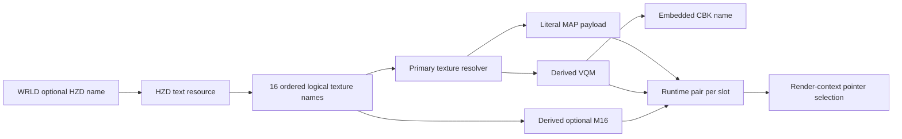

# HZD field-to-resource and runtime graph

Binary-static edges describe **attempts and ownership**, while corpus edges describe available payloads. Neither establishes native load success. Input identities and counts are in `../evidence/corpus.json`; anonymized payload inventory is in `dependency_inventory.json`.

| Source | Category | Edge / condition | Owner / release |
|---|---|---|---|
| WRLD payload+0x086, width13 | Serialized | Literal optional HZD name ->00401540 ->0046ffc0 | Temporary HZD lease;0046fd40 at0040167b after parsing |
| HZD ordered record i | Serialized | Literal texture logical name ->record[i].name ->00471c10 | Copied name; manifest bytes not retained |
| Literal texture name | Conditional direct | Generic acquisition directly, depending on primary pipeline preference/fallback | Retained primary pair pointer, release00447b20 ->0046fd40 if not decoded cache |
| Texture basename before first dot | Derived | Append `.vqm`; size/cache lookup ->VQM resource, decode | Decoded texture cache reference; release00447b20. Raw VQM temporary reference released after decode |
| VQM payload+8 C string | Indirect serialized in child | CBK acquire for decode | Temporary source/codebook lease, released after decode; complete VQM grammar outside this run |
| Texture basename before last dot | Derived/conditional | Append `.m16`; only if primary exists and005dd2a8==1; size then acquire | Pair+4 retained;00471e50 derives same name and releases0046fd40 |
| Built-in FULLRES.LST | Conditional built-in | High-color primary flag path, or optional M16 exists with header bit30 clear; global list flag not initialized | Acquire/release to global hash-bitset; not HZD data |
| Pair+0 / pair+4 | Derived state |00471f00 chooses using pointer availability and render context type | Borrowed by polygon submission; not another HZD acquisition |

The inventory resolves every one of272 distinct logical texture names:104 via direct MAP PIX members,168 via VQM PIX members with top-level CBKs; all168 also have M16 PIX members. Every used PIX slice is bounds-checked within its archive-authenticated PAK and hashed. All1,758 PIX indexes were examined. A missing loose MAP is therefore not a missing resource. Public hashed-name identifiers preserve joins without distributing the proprietary complete texture-name list.

Separate choices: mission-mode files select HZD names, HZD selects ordered names, generic resource globals select source precedence, high-color global controls optional companion acquisition, render context selects the pointer actually submitted. No HZD mode bit substitutes for those states. The resource provider may retain whole PAK ownership and has name-based release asymmetry documented in the accepted resource reference. A modern reader should report graph candidates independently of runtime activation, and a future loader should use explicit leases rather than guessing ownership from a raw pointer.

Unresolved: active mounted source ordering/collisions for a live game session, full decoder validity/asset-size requirements, all error cleanup inside the texture pipeline (including the statically identified unguarded null-primary FULLRES flag path), horizon geometry/angular mapping, palette/LUM/TBL application, blend/UV correctness. Successful lookup or decoder acquisition alone proves none of those.
