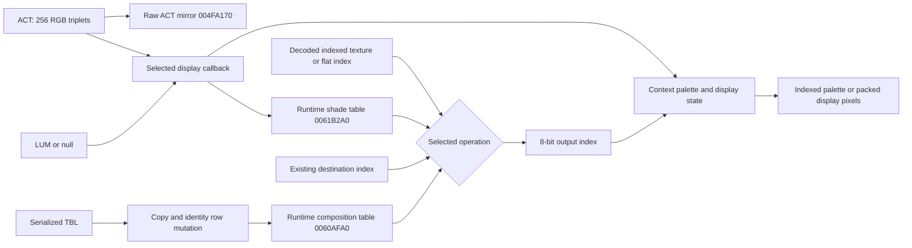

# ACT / LUM / TBL pipeline

This is a binary-static and authenticated retail-corpus research proposal, not a promoted specification. Retail EXE SHA-256 bc073a930da5b03793c086f22eeeff6f2cc7d9c81ce650c6656d0d0c49af13f3 and v100 GZF f21ce157703cb33ef265c2ddc98e5079c24f254f5ab7dd6ee87eaabe9d115bb0 identify the evidence. Existing Ghidra names are research aliases: the numerous “matrix” names in this region do not describe these color operations.

The original does **not** establish one compulsory ACT→LUM→TBL→RGB chain. ACT initializes palette/context/display state; LUM supplies an indexed shade remap; TBL composes a source index with an existing destination index. Selected rendering operations use different subsets. A consumer that returns an index has not yet returned an RGB pixel.

## Initialization boundaries

004B8A10 acquires ACT/LUM independently at 004B8A37/57. Non-null ACT copies 768 bytes to 004FA170 and invokes `[005DD2C4](005DCEC0,0,256,ACT,LUM)` at 004B8A9B. Null ACT skips both; null LUM does not skip the callback. Name-based releases follow. No local acquired-length checks protect those accesses.

The callback field is context+0x404. 00476000 selects/constructs a display context, and 00402EA6..00402EBA copies 0x10B dwords (0x42C bytes) into 005DCEC0, including that field. Five descriptors select four callback implementations: see PALETTE_CALLBACKS.md. Their common 004791E0 stage copies supplied LUM to 0061B2A0, or generates a replacement when null. Palette correction order differs by backend.

WRLD then independently acquires its TBL choice at 004B8ACC. On success 00478B30 initializes auxiliary tables and WRLD copies 65536 bytes to 0060AFA0. It subsequently calls 00479780(context,255), even when TBL acquisition failed. This installs an identity source row in TBL and auxiliary composition state. The raw resource and initialized runtime table must be different objects. The main loop also calls 00479780 at 004032F8.

## Verified consumers and next stage

| Operation | Original evidence | Inputs → output |
|---|---|---|
| Textured shade spans | 00485120, sample 00485406..16 | Unsigned sampled texel plus precomputed shade row offset → LUM byte → 8-bit destination |
| Flat shade spans | 0047CB00 at 0047CC43..66; 0047CFC0 | Flat palette index plus masked shade accumulator → LUM byte → 8-bit destination |
| Indexed composition/blit | 0047AA50 selector2 at 0047AF2F; 0047A220 at 0047A4BC | TBL[(source<<8)|destination] → 8-bit destination |
| Textured composition spans | 004828E0, 00483210, 00483CC0, 00484630 | Sampled texel in high byte, existing destination in low byte → TBL byte → 8-bit destination |
| Indexed-to-high-color blit | 0047AA50, 0047AB92..A5 / 0047AC45..53 | Source index → uint16 table00608460[index] → 16-bit destination; selected modes skip source255 |
| Display palette submission | Four callbacks | Context triplets → PALETTEENTRY/device palette or packed conversion state; see ACT report |

Texture sampling here uses runtime texture header width/height and pixels at +8; scanline addresses are cached at 006439D8. This establishes where decoded indexes enter color processing; it does not newly prove VQM/CBK decoding. Source decode/acquisition remains the accepted separate texture-resource boundary.

## Evidence and limits

`evidence/reviewed_instructions.json` contains curated original instructions; `instruction_validation.json` authenticates larger exported bodies/windows against the PE. `table_references.json` inventories references over entire table ranges and a whole-listing immediate/displacement scan. Propagated references and computed addresses are included. This is not a proof of absence of arbitrary aliases, unrecognized code, self-modification, or external-DLL readers. Hardware plugin internals and complete span dispatch/float interpolation are outside this renderer boundary.

The standalone model executes the verified copy/integer contracts, supplied-LUM path, correction-LUT application, packed palette conversion, nearest-color cache, and runtime TBL mutations. It explicitly does not implement null-LUM x87 generation or CRT power-table generation. No native rendering, gameplay execution, renderer equivalence, visual fidelity, or explanation of every historical material mismatch is claimed.
