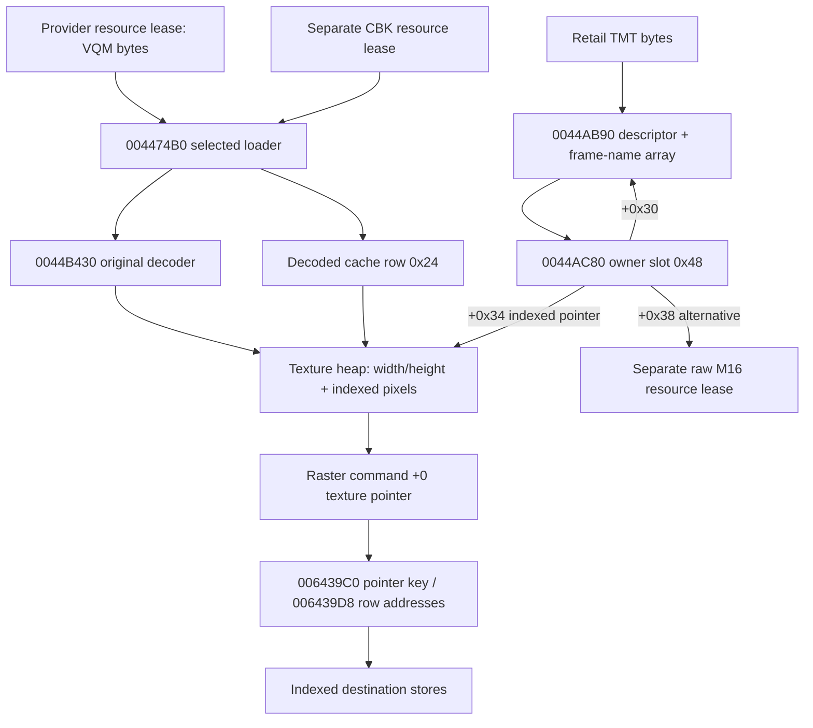

# Runtime texture structures and ownership

**O** connected TMT/owner/loader/decoder fixture; **S** release, eviction and
wider dispatch paths. Addresses below are retail globals unless explicitly
marked fixture allocation. Descriptive names are research aliases.

| Runtime indexed texture offset | Contract |
|---|---|
| +0 DWORD | width and row pitch in bytes |
| +4 DWORD | height plus runtime flags; sampling strips high3 bits with SHL/SAR |
| +8 | first row of contiguous unsigned index bytes |

No additional texture-object pointer or row-pitch word is between header and
pixels. For 64x64 examples, original HeapAlloc request is 4104 bytes. The
returned pointer is the header pointer, not first texel. Decoder original
instructions fill every output byte; the host does not copy/reconstruct that
buffer before authentic fixture sampling.

Decoded-cache row: +00 char key[16], +10 texture pointer, +14 u16 reference
count, +16 u16 flags (low bits govern LRU/video status), +18/+1C LRU links,
+20 hash-chain link. Hash heads begin 00531B40, 109 buckets; LRU head/tail
00531B38/3C. Row heap handle 00531CF4, texture heap handle 00531CF8, accounting
00608E58. These cache rows are not RES loaded-file records or per-owner slots.
Cache release 00447B20 normalizes to VQM, decrements u16 refs, adds zero-ref rows
to LRU, or releases original incoming name through RES if no decoded row exists.
Eviction 00447E10 unlinks a zero-ref row, adds masked-size+8 back to accounting
and frees texture plus cache row. Release/eviction are static here; true Win32
heap lifetime, failed allocations and live renderer/eviction overlap are untested.

Owner-slot 0x48: +00 owner, +04 current frame name[16], +14 logical material
name[16], +24 dimension-index words, +30 TMT descriptor, +34 indexed texture,
+38 M16 pointer, +3C flags (bit1 dirty), +40 owner/name hash chain, +44 owner-list
link. Original 0044AC80 copies descriptor array entry zero into current name,
sets dirty=2 and both pointers null. 0044A290 loads indexed pixels on dirty and
clears dirty, even when that load fails; it does not retry every clean lookup.
Prior accepted 0044A0B0 invalidation marks eligible slots dirty again, preserving
TMT ownership; this run does not repeat that prior release experiment.

TMT descriptor 0x34: +14 timing float copied from source+28, +18 flags from
source+2C, +1C dimension count from source+14, +20 onward cumulative dimension
products, +2C frame-name array, +30 descriptor hash link. 0044AB90 allocates
16*product bytes, copies each source 8-byte basename from source+40 and appends
`.map`. Our authentic TMTs have one dimension, product4, flags0. We call that
original decoder directly into supplied descriptor backing; descriptor-cache
registration/refcount setup and animation scheduling are not exercised.

## Connected fixture memory

Both independent emulator states happen to use the same supplied heap sequence:
owner identity 20012000; descriptor 20800000; owner slot 208000C0; texture
20800180. The coincident addresses do not identify a shared game object. Exact
allocation sizes, slot words, TMT identities and original service chronology
are in `execution.json`. Descriptor and frame-array allocations precede texture
allocation. A second direct 004474B0 call returns the same texture and increments
its cache reference; it is deliberately not a full release/teardown test.

## Row cache

0048513D..004851E7 compares command texture pointer against 006439C0. On change,
it stores the pointer and fills 006439D8[y] = texture+8+y*width for exactly the
masked positive height, using a remainder loop then groups of four. A repeated
pointer skips rebuilding; width/height masks are still read for each callback.
All row addresses are checked against original writes in the fixtures. Shade
and composition callbacks share this pointer-keyed cache. Texture contents are
read live; row addresses are cached, not texel values.

The static xref inventory finds direct cache-key writes in the texture callback
family; it finds no additional direct reset in the inspected allocation/eviction
functions. This is not a proof against computed aliases. Mutation/reuse of the
same allocation address with a different pitch needs lifecycle reconciliation;
no safe global invalidation protocol is established. An independent interface
should key row views by texture identity/generation or rebuild them, while
preserving the verified contiguous pixel representation.
